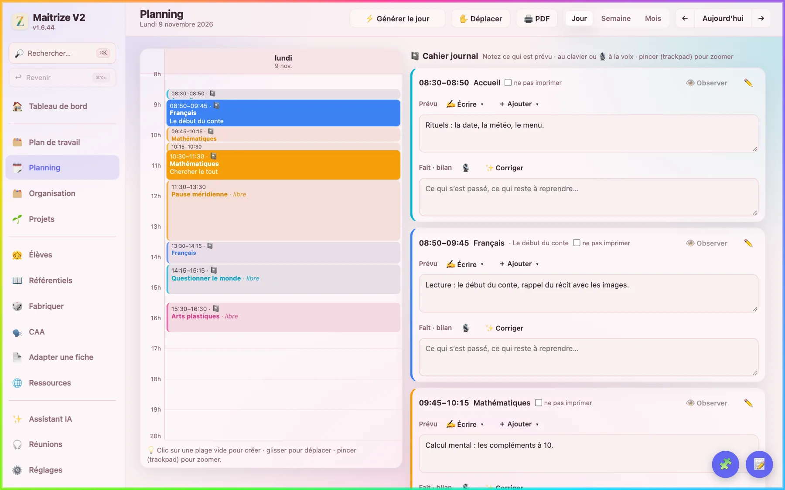
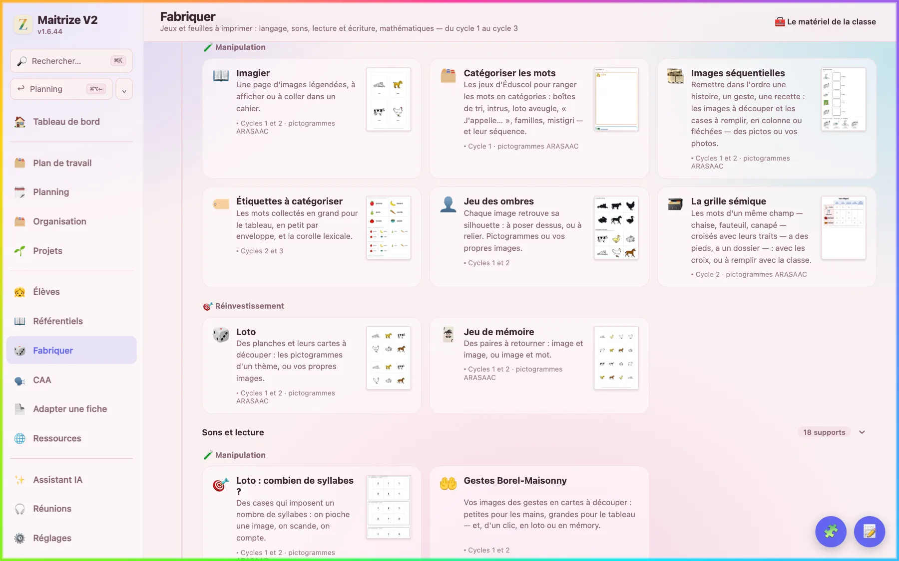

# Maitrize

Préparer sa classe, tenir son cahier journal, fabriquer ses feuilles, suivre ses élèves : une application libre et gratuite pour Mac et Windows, faite par un enseignant pour ses collègues.

**[Télécharger pour Mac](https://forge.apps.education.fr/clementtitet/maitrize/-/releases/permalink/latest/downloads/Maitrize-Mac.dmg)** · **[Télécharger pour Windows](https://forge.apps.education.fr/clementtitet/maitrize/-/releases/permalink/latest/downloads/Maitrize-Windows.exe)** · **[La page d'accueil](https://clementtitet.forge.apps.education.fr/maitrize/)** · **[Le mode d'emploi](https://clementtitet.forge.apps.education.fr/maitrize/mode-d-emploi.html)**



## Pour qui

Les enseignants du premier degré, de la petite section au CM2, et les enseignants d'ULIS ou d'établissements médico-sociaux. Il n'y a rien à savoir de l'informatique : on télécharge, on installe, on ouvre.

## Ce qu'elle fait

- **Le cahier journal et le planning**, repris de votre emploi du temps : le prévu et le bilan de chaque créneau, au clavier ou à la voix, et la journée en PDF.
- **Plus de 150 modèles de feuilles à imprimer**, du cycle 1 au cycle 3 : fiches, jeux, lotos, outils pour l'élève, affichages, avec de vrais pictogrammes ou vos photos.
- **Des séquences toutes faites**, de la petite section au CM2, en tableau période par période, avec leurs séances et leurs feuilles.
- **Le suivi des élèves** : observations datées, dossier, évaluations, papiers, et pour l'école inclusive PPS, PAP, PAI, PPRE, PPI et GEVA-Sco.
- **La communication en images (CAA)** : consignes en pictogrammes, tableaux de langage, supports visuels, planches.
- **L'année** : programmation, progression, travail de cycle, plan de salle, pages de garde.
- **Un compagnon sur iPhone**, [MaitrizeV2 Compagnon](https://apps.apple.com/fr/app/maitrizev2-compagnon/id6823327211) : dictées et notes de la journée, cahier journal du jour, tablettes des élèves.
- **Un assistant IA, seulement si vous le voulez**, avec votre propre clé Mistral.



## Ce qu'il faut

- Un Mac sous macOS 11 ou plus récent, ou un PC sous Windows 10 ou 11 en 64 bits.
- Une connexion pour l'installation des pictogrammes (environ 410 Mo, une fois). Ensuite, ce qui ne demande ni IA ni partage fonctionne hors ligne.

## Installer

Téléchargez le fichier de votre ordinateur, ouvrez-le, suivez [le mode d'emploi](https://clementtitet.forge.apps.education.fr/maitrize/mode-d-emploi.html#installer). Ensuite, l'application se met à jour toute seule. Toutes les versions sont dans [la page des versions](https://forge.apps.education.fr/clementtitet/maitrize/-/releases), et ce qui change dans [le journal des versions](CHANGELOG.md).

## Vos données

Tout s'enregistre sur votre ordinateur : il n'y a ni compte Maitrize, ni serveur Maitrize. Sans clé d'IA, le reste de l'application fonctionne sans elle. Avec votre clé, les demandes sont traitées dans l'Union européenne et les noms des élèves sont masqués, sauf la conversation à voix haute et la recherche sur internet de l'assistant, que l'application signale ; la voix, si vous choisissez la transcription en ligne, part telle quelle. Le détail est dans [le mode d'emploi](https://clementtitet.forge.apps.education.fr/maitrize/mode-d-emploi.html#ia).

## Licence et auteur

Maitrize a été créé par Clément Titet, enseignant. C'est un logiciel libre, sous licence [GNU AGPL, version 3 ou ultérieure](LICENSE), avec les conditions supplémentaires de [NOTICE](NOTICE) : une version modifiée reste libre, garde la mention de son auteur et porte un autre nom.

Ce qui vient d'autres auteurs garde ses propres conditions (voir [NOTICE](NOTICE) et, dans l'application, Réglages › Licences). Les pictogrammes visibles sur les captures : auteur Sergio Palao, origine ARASAAC (arasaac.org), licence CC BY-NC-SA 4.0, propriété du Gouvernement d'Aragon (Espagne). Les captures montrent une classe inventée.

## Une idée, un problème

Écrivez à [contact@maitrize.com](mailto:contact@maitrize.com), ou ouvrez un ticket sur ce projet. Dans l'application, un rapport d'erreur se prépare d'un clic, nettoyé des noms de la classe. Pour proposer du code, parlons-en d'abord dans un ticket. Il ne doit jamais y avoir de prénom d'élève dans un ticket, un essai ou un commit.

## Pour lire ou construire le code

L'application est faite avec [Tauri](https://tauri.app) : une interface React et TypeScript (`src/`), une partie Rust (`src-tauri/`), une base SQLite locale. Le compagnon iPhone est dans `compagnon/`.

```bash
npm install
npm run tauri dev      # lancer en développement
npm test               # les essais de l'interface
npm run tauri build    # construire l'installeur de cet ordinateur
```

Sur cette Forge, `.gitlab-ci.yml` lance les essais à chaque publication, construit l'installeur Windows et met en ligne cette page et les téléchargements.
